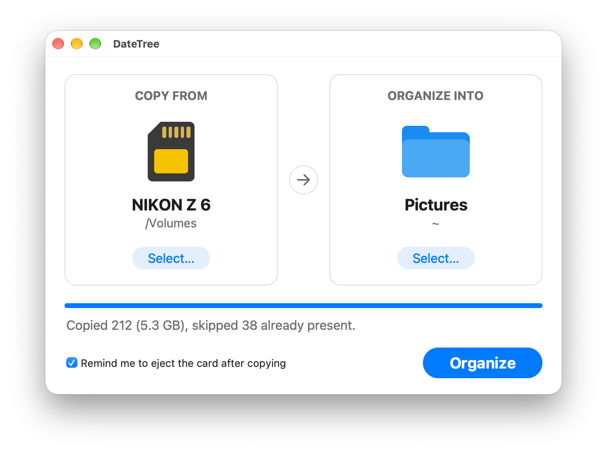

# DateTree

A small macOS GUI app that copies Nikon `.NEF` raw files out of a card or
folder and files them into date folders under a destination of your choosing:

```
<destination>/YYYY-MM-DD/<filename>.NEF
```

The date comes from the photo's own EXIF capture time, so files land under the
day the shutter fired rather than whenever they were last touched.

<p align="center">
  <picture>
    <source media="(prefers-color-scheme: dark)" srcset="docs/screenshot-dark.png">
    
  </picture>
</p>

## Origin and credit

This is a reimplementation of **DateTree by Colin Henein**
(<https://www.orange-carb.org/DateTree/>, version 1.3, ©2020) — the macOS app
that has handled this job for me for years. The name, the two-panel window, and
the "Copy From:" / "Organize Into:" wording are all his. Screenshots of his app
were the entire specification for this one.

I have tried to contact Colin about it without success; the app has been around
long enough that he no longer seems to respond to enquiries about it.

The reason for rebuilding it is simply that the original is no longer maintained
and is expected to stop working on forthcoming macOS releases. I would rather
keep the workflow than lose it when that happens.

This is an independent, from-scratch implementation in Python. No code from the
original was used, inspected or decompiled — only its visible interface was
reproduced. It is not affiliated with or endorsed by Colin Henein. With thanks
to him for the original, which was a pleasure to use.

## Use at your own risk

This software is provided as is, with no warranty of any kind. No
responsibility is accepted for any data loss, file corruption, or other damage
or inconvenience arising from its use. You use it entirely at your own risk.

It is written to be conservative with your photographs — it only ever reads
from the source folder, never moves or deletes anything, and skips files that
already exist at the destination — but no software is free of bugs. **Check
that your photographs have arrived safely before erasing a card, and keep
backups.**

The MIT licence at the foot of this file says the same thing in formal terms.

## Download

Ready-built copies are on the
[Releases page](https://github.com/deevodavis71/DateTreePy/releases). Unzip
the download and move **DateTree.app** to Applications. That build bundles its
own Python, so it needs nothing else installed, and it runs on Apple silicon
and Intel Macs (macOS 12 or later).

The app isn't notarized by Apple, so macOS refuses to open it the first time.
Open **System Settings › Privacy & Security**, scroll down to the message about
DateTree and click **Open Anyway**. You only have to do this once.

Everything below is about running from source.

## Requirements

- Python 3.13+ with Tk support. On macOS:
  ```sh
  brew install python-tk
  ```
- No third-party packages. The NEF date reader parses the file's TIFF
  structure directly using only the standard library.

## Running

Double-click **DateTree.app** in the project root, or from a terminal:

```sh
./start.sh          # or its full path, from anywhere
```

`DateTree.app` is the better route for anything that isn't a terminal — Finder,
the Dock, Spotlight, Automator — because it goes through LaunchServices, which
activates the app properly (see below). It can be dragged to the Dock or
aliased into `/Applications`; it keeps working from anywhere because the project
location is baked into its launcher. Startup problems are logged to
`~/Library/Logs/DateTree.log`.

`start.sh` can be run from any directory, finds a Python that actually has Tk
(set `DATETREE_PYTHON` to force a particular interpreter) and tells you how to
fix it if there isn't one. `python3 -m datetree` from the project root works
just as well.

Pick a source folder on the left (**Copy From**) and a destination on the
right (**Organize Into**), then press **Organize**. Click anywhere on a card to
choose its folder. Each card shows the folder's name and location, and
hovering over it shows the full path. While a copy runs, the button turns into
**Cancel** and the cards are locked. The window follows the system's light or
dark appearance.

Both folders are remembered and re-selected the next time the app starts. If a
remembered folder has gone away — an ejected card, a renamed folder — that side
is left empty and the status line says so. The choices live in
`~/Library/Application Support/DateTree/settings.json`; deleting that file just
resets the app to an empty first-run state.

Tick **Remind me to eject the card after copying** to get a popup, once a copy
finishes, telling you to eject the card and remove it. It names the volume, and
only appears when the source is on a mounted volume (something under
`/Volumes`), the run wasn't cancelled and nothing failed to copy. The tick box
is off by default and is remembered alongside the folders.

To spot-check the date reader against real files without opening the GUI:

```sh
./start.sh /Volumes/NIKON\ Z\ 6/DCIM/100ND750/DSC_0001.NEF
# 2026-07-25  (exif)  DSC_0001.NEF
```

## Launching from Automator, launchd or cron

Automator's *Run Shell Script* action runs inside an XPC service rather than a
foreground GUI app: `SECURITYSESSIONID` is unset and nothing activates the
process. An unactivated Aqua process never gets its first draw pass, so the
window used to appear blank at the correct size. `activate_window()` in
`gui.py` asks for focus at startup, which triggers that paint. The same applies
to launchd agents and cron.

The robust fix is to let LaunchServices start the app, which sidesteps process
activation entirely. In an Automator *Run Shell Script* action use:

```sh
open -a /path/to/DateTreePy/DateTree.app
```

`open` returns immediately, so the workflow finishes instead of sitting there
spinning for as long as the app is open.

## The app bundle

`DateTree.app` is a script-based bundle and a **build artifact — it is not
tracked in git**, because its launcher has an absolute project path baked in, it
links a machine-specific Python and it carries an ad-hoc signature. Build it
after cloning, and rebuild it after a Python change:

```sh
./tools/make_app.sh          # bundle, Info.plist, icon, ad-hoc signature
python3 tools/make_icon.py   # only to regenerate assets/DateTree.icns
```

`tools/launcher.sh.in` is the launcher template; `make_app.sh` generates the
real launcher from it with the project path baked in. The icon is a tracked
source asset at `assets/DateTree.icns` and gets copied into the bundle.

One wrinkle is worth knowing about. Homebrew's `python3` binary lives *inside*
`Python.app`, and macOS attributes a process to whichever bundle its executable
sits in — so launching Python at its own path makes the app show up in the Dock
and menu bar as "Python", with Python's icon, no matter what our `Info.plist`
says. `make_app.sh` therefore symlinks that binary to
`DateTree.app/Contents/MacOS/python-gui` and the launcher execs it *through the
symlink*, which puts the executable path inside our bundle and gets DateTree's
own name and icon. Framework Python still resolves its prefix correctly through
the symlink.

That symlink is version-specific — currently `python@3.14`. It goes through
Homebrew's stable `/opt/homebrew/opt/python@3.14` prefix, so **patch upgrades
(3.14.6 → 3.14.7) keep working**. Re-run `./tools/make_app.sh` when you either:

- move to a new minor version (`python@3.15`) and want the app to use it — the
  bundle otherwise keeps quietly running on the old one for as long as it is
  installed; or
- uninstall the version it points at, which leaves the symlink broken. The app
  still launches (the launcher falls back to `start.sh`), it just appears as
  "Python" again.

The icon is generated by `tools/make_icon.py`, which writes PNGs at all ten
sizes macOS wants using nothing but `zlib` and `struct`, then calls `iconutil`.
No imaging library needed.

## Troubleshooting

**The app is called "Python" again, with the wrong icon.** The `python-gui`
symlink is broken because the Python version it pointed at was uninstalled:

```sh
./tools/make_app.sh
```

**The app is still running an old Python** after installing a newer one. The
bundle keeps using whichever version `make_app.sh` linked. Same fix:

```sh
./tools/make_app.sh
```

**Nothing starts and `~/Library/Logs/DateTree.log` says it needs a Python with
Tk support.** Every candidate interpreter lacks `tkinter`:

```sh
brew install python-tk    # installs it for the current Homebrew Python
./tools/make_app.sh
```

**The window is blank.** Something launched it without activating it — see
*Launching from Automator, launchd or cron* above; use
`open -a .../DateTree.app` rather than running the script directly.

**Nothing happens when the app is launched.** Check
`~/Library/Logs/DateTree.log`, which records every launch, the project path it
resolved and which Python it used.

## Behaviour

- **Recursive.** Every `.NEF` under the source folder is considered, at any
  depth. The match is case-insensitive, so `.nef` and `.NEF` both count.
- **Date source.** `DateTimeOriginal` is preferred, then `DateTimeDigitized`,
  then the TIFF `DateTime` tag. If none of those are readable the file's
  filesystem modification time is used instead, and the status line reports how
  many files needed that fallback.
- **Duplicates are skipped.** If the destination day folder already holds a
  file of the same name, it is left alone and counted as skipped. Re-running
  over the same card is therefore cheap and never overwrites anything.
- **Copies are atomic.** Each file is written to a hidden temporary file in the
  destination folder and renamed into place only after its size is verified, so
  an interrupted run cannot leave a truncated file that a later run would skip.
- **Timestamps are preserved** on the copies (`shutil.copystat`).
- **Nothing is moved or deleted.** The source is only ever read.
- **`._*` files are ignored.** These are macOS AppleDouble metadata stubs that
  appear on exFAT/FAT cards, not photographs.
- **A destination inside the source is safe.** That folder is pruned from the
  scan, so freshly copied files are not picked up and copied again.

## Layout

| Path | Purpose |
| --- | --- |
| `DateTree.app` | Double-clickable app bundle (generated, untracked) |
| `start.sh` | Terminal launcher |
| `assets/DateTree.icns` | App icon (tracked; generated by `make_icon.py`) |
| `tools/make_app.sh` | Rebuilds the bundle |
| `tools/launcher.sh.in` | Template for the bundle's launcher |
| `tools/make_icon.py` | Generates the icon, standard library only |
| `datetree/exif.py` | Dependency-free EXIF capture-date reader for NEF/TIFF |
| `datetree/organizer.py` | File discovery and the copy engine |
| `datetree/gui.py` | Tkinter interface |
| `datetree/settings.py` | Remembers the last-used folders and options between runs |
| `datetree/__main__.py` | Entry point and the date-inspection helper |
| `tests/` | Unit tests plus GUI tests that drive the real widgets |
| `docs/` | README screenshots (`python3 tools/screenshots.py --readme`) |

## Tests

```sh
python3 -m unittest discover -s tests -t .
```

`tests/nef_fixture.py` builds tiny synthetic NEFs (valid TIFF containers with
real EXIF date tags, both byte orders) so the date logic can be tested without
committing 25MB raw files.

## Making a release

`.github/workflows/release.yml` builds and publishes a release when a version
tag is pushed. The tag must match `__version__` in `datetree/__init__.py`:

```sh
# bump __version__, commit, then:
git tag v1.1.0
git push origin main v1.1.0
```

CI installs python.org's universal2 Python (pinned by checksum), runs the
tests, freezes the app with `tools/build_release.sh` and attaches
`DateTree-<version>-macOS-universal2.zip` to a new GitHub release. To try the
same build locally (for this Mac's architecture only):

```sh
./tools/build_release.sh     # -> dist/DateTree.app and dist/DateTree-*.zip
```

That script uses [PyInstaller](https://pyinstaller.org) to bundle Python and
Tk into the app. PyInstaller is a build tool only: it goes into a throwaway
venv under `build/`, and the app itself still uses nothing outside the
standard library. `make_app.sh` and `build_release.sh` serve different
purposes. The first makes a lightweight bundle that runs this checkout; the
second makes a standalone copy you can hand to someone else.

## Licence

MIT — see [LICENSE](LICENSE). It includes the usual disclaimer of warranty and
liability; see *Use at your own risk* above.

That covers this implementation, which is entirely original code. It grants no
rights in the original DateTree, its name or its design, which remain Colin
Henein's; see *Origin and credit* above.
